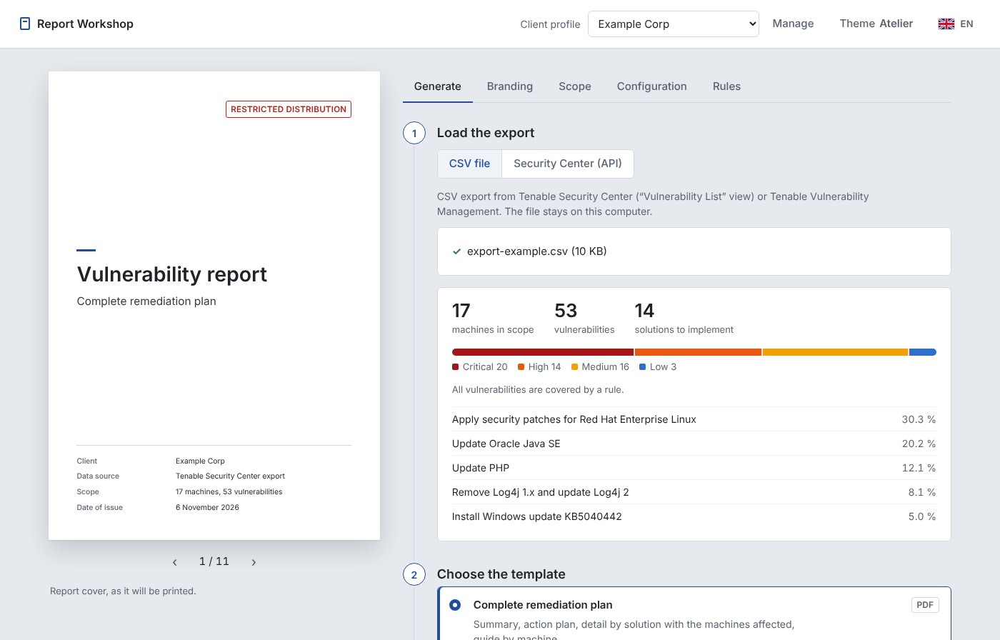
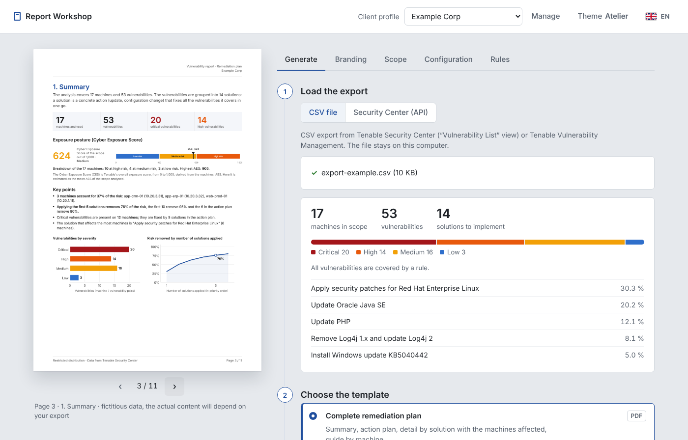
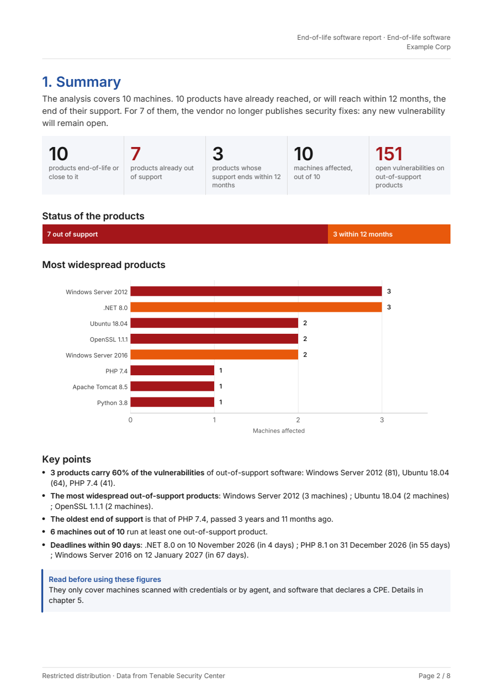
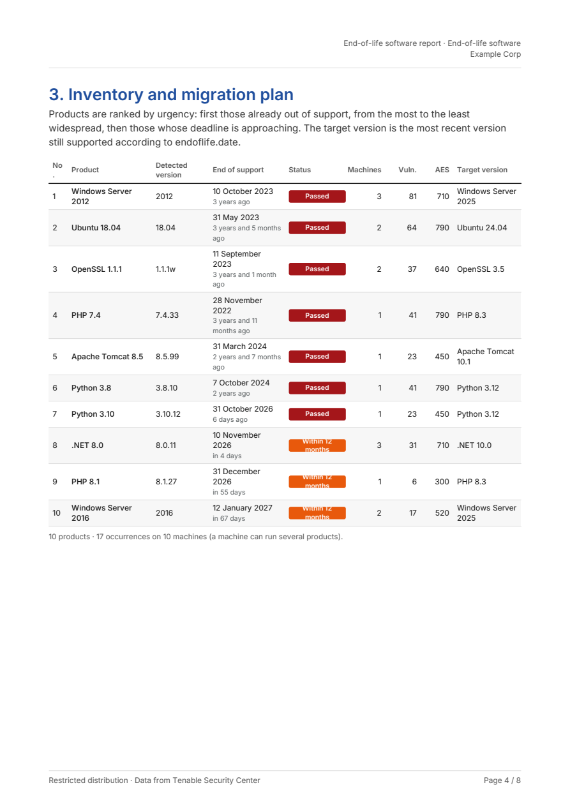
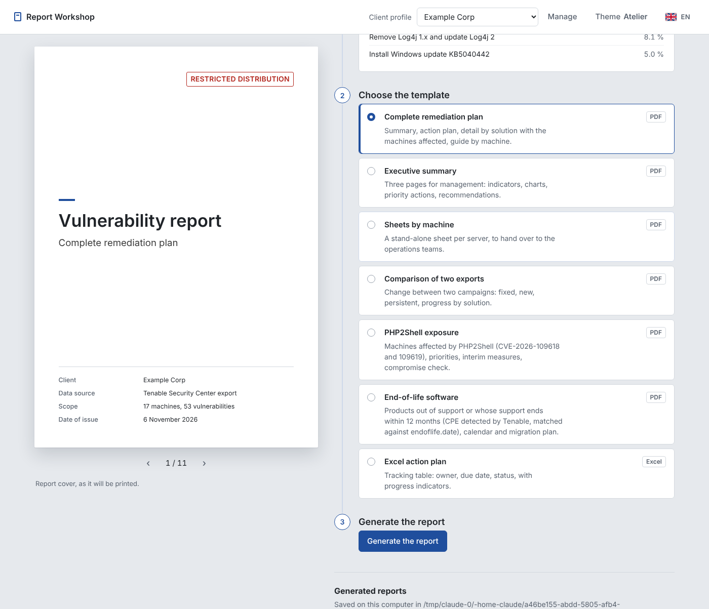

# Tenable Report Workshop

A local application that turns Tenable vulnerability data into client-ready remediation reports (PDF and Excel). It reads a CSV export, or queries the Security Center or Tenable Vulnerability Management API directly. It then groups findings into concrete remediation actions, ranks them by risk, and produces branded reports in French, English, Spanish or Italian.

Two more documents go into detail on every feature:

- the illustrated **user guide** (English, PDF): [Report_Workshop_User_Guide.pdf](Report_Workshop_User_Guide.pdf);
- the French documentation: [LISEZMOI.md](LISEZMOI.md).

## Screenshots





| | |
|---|---|
|  |  |

The illustrated [user guide](Report_Workshop_User_Guide.pdf) has more.

## What it does

- **Imports vulnerability data** from:
  - a Tenable Security Center CSV export (Analysis > Vulnerabilities > Vulnerability List > Export as CSV), including one re-saved by Excel with a semicolon separator and decimal commas
  - a Tenable Vulnerability Management CSV export
  - the Security Center REST API (`POST /rest/analysis`) or the Vulnerability Management export API, using a profile's saved query or a scope picked in the app (Security Center asset lists, Vulnerability Management tags)
- **Lists end-of-life software**: the CPE that Nessus reports (plugin 45590) are matched with [endoflife.date](https://endoflife.date) to show which products are out of support or about to be, on which machines, with the open vulnerabilities.
- **Turns plugin names into actions** with an editable rule set (`regles/`). For example, many "Product < X" findings become a single "Install Product version X or later" action. Rules cover Linux/Unix, Windows, the main network and security vendors, industrial systems and protocols, and common issues such as TLS, certificates, SSH, SMB, SNMP, DNS, WPAD, credentials sent in cleartext and Secure Boot.
- **Ranks the actions with Tenable's scoring**, whichever product the data comes from: by severity (Critical 40, High 10, Medium 3, Low 1, the scale behind the Security Center vulnerability score), by VPR, or by VPR × ACR. ACR, AES and an estimated Cyber Exposure Score are shown when the data has them: Security Center and Vulnerability Management both provide them through their API.
- **Applies each client's branding** through profiles: logo, main colour, title, footer, distribution notice and watermark. An optional "Tenable" theme switches the reports to the Tenable visual identity.
- **Shows the scope of every report.** The asset lists or tags picked for an API retrieval appear on the cover and in the footer of every page, and stay attached to the saved CSV.
- **Can email the report** through your own SMTP server, but only when you explicitly ask it to.

## Prerequisites

- Python 3.9 or later ([python.org](https://www.python.org/downloads/)). On Windows, tick "Add Python to PATH" during installation.
- Internet access on first launch, to install the Python libraries listed in [requirements.txt](requirements.txt) (Flask, pandas, matplotlib, ReportLab, Pillow, openpyxl, requests, pypdfium2). For offline machines, see "Machine without Internet access" in LISEZMOI.md.
- Optional, for API retrieval: a Security Center or Vulnerability Management account with API keys. A read-only account is recommended.
- Optional, for email: an SMTP server.

## Installation and running

```bash
git clone https://github.com/blckdvc/Tenable-Report-Workshop.git
cd Tenable-Report-Workshop
```

| System | Start |
|---|---|
| Windows | Double-click `lancer.bat` |
| macOS | Double-click `lancer.command` (first time: right-click, then Open) |
| Linux / macOS terminal | `./lancer.sh` |

On first launch, the script creates a `.venv` virtual environment and installs the libraries, which takes one to two minutes. The app then opens in your browser at http://127.0.0.1:8765. Close the terminal window to stop it.

To install manually instead:

```bash
python3 -m venv .venv
.venv/bin/python -m pip install -r requirements.txt
.venv/bin/python app.py
```

### Using the app

1. Choose or create a **client profile** (top right).
2. **Generate** tab: drop a CSV export, or pick the API source ("Security Center (API)" or "Vulnerability Management (API)") and click the fetch button, then choose a report template and click "Generate report". During an API retrieval, a **Retrieval log** box under the button shows each step live (export created, status, chunks or pages received, conversion).
3. **Branding**, **Scope**, **Rules** and **Configuration** tabs: set up the client's branding, choose which severities and machines to include, edit the remediation rules, and configure API and SMTP connections.

Each template has a "See an example" button: the cover preview then shows the selected template filled with fictitious data, page by page (‹ › arrows).



For the end-of-life report, select its template **before** fetching through the API, so the software list is collected with the vulnerabilities.

### Command line

```bash
.venv/bin/python generer.py export.csv --modele synthese --profil my-profile
.venv/bin/python generer.py old.csv recent.csv --modele comparaison --sortie trend.pdf
.venv/bin/python generer.py --api --profil my-profile --mail default --langue en
```

Options: `--modele` (`complet`, `synthese`, `fiches`, `comparaison`, `php2shell`, `eol`, `plan_excel`), `--profil`, `--sortie`, `--theme` (`atelier` or `tenable`), `--langue` (`fr`, `en`, `es`, `it`), `--api` / `--securitycenter`, `--mail`. These work well in a scheduled task (cron or Windows Task Scheduler).

### Fetching from Tenable Vulnerability Management

Choose **Configuration > Tenable product > Vulnerability Management** (a profile setting), enter the address (`https://cloud.tenable.com` by default) and API keys, then set the profile's export query:

- **Detection period**: 30 days (Tenable's default), 90, 180, 365 days, or the whole period. Without a date, the export API only returns vulnerabilities seen in the last 30 days, so machines that haven't been rescanned since disappear from the report.
- **Address range** (optional).
- **ACR and AES**: read from the asset export (`POST /assets/v2/export`, followed under `/assets/export/{uuid}`). If that export is refused, the app reads the scores from the workbench asset list, then tries the asset export v1.

**Choose the scope** on the Generate tab picks tags by category (OR within a category, AND between categories) and counts the machines first. If the export's tag filter returns nothing or is rejected, the app looks up the assets carrying those tags in the workbench and selects their vulnerabilities locally. The retrieval log shows which path was used.

### API keys and configuration

Connection settings are stored in `config.json`. The app creates this file when you first save settings, and makes it readable by your user only. It is excluded from git. You can supply credentials through environment variables instead, which take precedence:

| Variable | Purpose |
|---|---|
| `TENABLE_SC_URL`, `TENABLE_SC_ACCESS_KEY`, `TENABLE_SC_SECRET_KEY` | Security Center |
| `TENABLE_VM_URL`, `TENABLE_VM_ACCESS_KEY`, `TENABLE_VM_SECRET_KEY` | Tenable Vulnerability Management |
| `SMTP_HOST`, `SMTP_USER`, `SMTP_PASSWORD` | SMTP server |

## Outputs

Reports are saved in `rapports/`. Data fetched through the API is saved as timestamped CSV files, in `exports_security_center/` for Security Center and `exports_vulnerability_management/` for Vulnerability Management, so it can be reused for comparisons. These files carry the selected scope in a `Scope` column, so a report built from them later still shows it.

Every PDF shows the data source and the scope on the cover and in the footer of each page, for example "Data from Tenable Vulnerability Management · Scope: Tags: Asset Owner = ludo". A customised footer text is kept as is. The full remediation plan only presents the number of solutions set on the Scope tab.

| Template | Format | Contents |
|---|---|---|
| Full remediation plan (`complet`) | PDF | Graphical summary, action plan, detail per action with affected machines, per-machine guide |
| Executive summary (`synthese`) | PDF | Three pages for management: key figures, charts, top 10 actions, recommendations |
| Per-machine sheets (`fiches`) | PDF | One self-contained sheet per machine, with a checklist of actions and a tracking box |
| Comparison of two exports (`comparaison`) | PDF | Risk score trend, and fixed, new and persistent vulnerabilities, by action and by machine |
| PHP2Shell exposure (`php2shell`) | PDF | Themed report on CVE-2026-109618 / CVE-2026-109619: affected machines by priority, action plan, interim measures, compromise checks |
| End-of-life software (`eol`) | PDF | Software out of support or soon to be (CPE matched with endoflife.date): summary, inventory, one sheet per product with machines and open vulnerabilities |
| Excel action plan (`plan_excel`) | XLSX | Tracking of actions (owner, due date, status), per-machine status, vulnerability detail, progress indicators that recalculate automatically |

## Network and data flows

The web server listens on `127.0.0.1` only, and the interface loads no external resources. Data leaves your machine only in these cases, each started by you:

- calls to the **Security Center** URL you configure, or to **Tenable Vulnerability Management** (`https://cloud.tenable.com` by default), to fetch vulnerability data;
- calls to **endoflife.date** (public API, only for the end-of-life report) to read product lifecycle dates; behind a TLS-inspecting proxy, set its root certificate in the dedicated endoflife.date block of the Configuration tab (separate from the Tenable certificates);
- sending a report by **email** through the SMTP server you configure;
- installing Python packages from PyPI on first launch.

There is no telemetry and no other outbound call.

## Known limitations

- **Remediation actions are inferred from plugin names.** Target versions come from Tenable's plugin names and the rule set, so have a technical team review the action plan before you send it to a client. Findings that match no rule fall back to the plugin's `Solution` text.
- **Vulnerability Management CSV exports are less complete.** They have no ACR, AES or last-seen date, and a machine is identified by its first IPv4 address.
- **Comparisons only count fixes on rescanned machines.** A vulnerability is counted as fixed only if its machine appears in the recent export, with any finding (Info included). A machine missing from the recent export is reported as "not rescanned".
- **Very large exports take time to lay out.** On 58,000 findings across 3,000 machines, the analysis takes about 1.5 s, the executive summary under 1 s, the comparison about 3 s, the Excel plan about 12 s, and the full plan and per-machine sheets 40 to 50 s each (one PDF page per machine).
- **The PHP2Shell template is dated.** Its threat summary was written as of 25 October 2026, so review it before using it for later reports.
- **Vulnerability Management only returns recent findings by default.** Without a date filter, its export API returns vulnerabilities seen in the last 30 days, so machines that haven't been rescanned since are missing. Widen the profile's "Detection period" (90, 180, 365 days or the whole period) to include them.
- **Email attachments are limited to 25 MB.**
- **The interface and code comments are mostly in French.** The reports themselves are available in four languages.

## Project layout

| Path | Role |
|---|---|
| `app.py` | Local web server and interface |
| `generer.py` | Command-line generation |
| `moteur/` | Export parsing, rules, charts, report templates (`moteur/modeles/`), Security Center and Vulnerability Management clients, SMTP sending |
| `outils/guide/` | Script that builds `Report_Workshop_User_Guide.pdf`, with its screenshots: `.venv/bin/python outils/guide/generer_guide.py` |
| `web/` | Interface (HTML, CSS, JavaScript) |
| `regles/` | Remediation rules: `base.csv` (grouping) and `textes_<lang>.csv` (texts per language) |
| `profils/` | Client profiles (branding, scope, logo) |
| `polices/` | Inter and DejaVu fonts (open licences included) and Tenable logos |

## License

[MIT](LICENSE). Bundled fonts keep their own licences: see `polices/LICENCE-Inter.txt` and `polices/LICENCE-DejaVu.txt`. Tenable and its logo are trademarks of Tenable, Inc.
